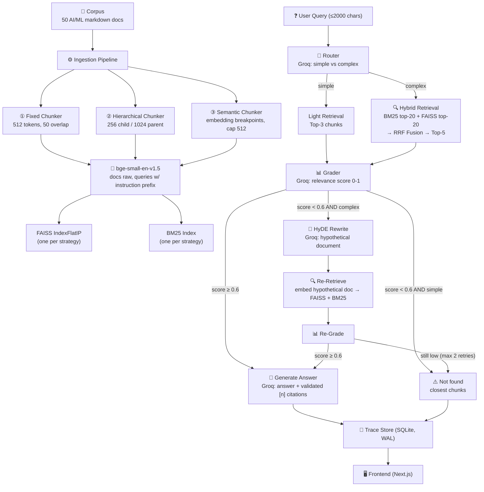

# Sentinel RAG — Implementation Plan

> "Most RAG systems fail silently. Mine knows when it's failing, fixes itself, and shows you the receipts."

A locally hosted, self-correcting RAG laboratory with 3 chunking strategies and an agentic self-correction loop (Grader + HyDE) — all visualized in a live web UI.

---

## Confirmed Design Decisions

All decisions are locked. This table is the single source of truth; `config.py` mirrors it.

| Decision | Choice |
|---|---|
| **Corpus** | 50 synthetic markdown docs on **Full AI/ML spectrum** (fundamentals → LLMs → RAG → agents → MLOps) |
| **Fixed chunker** | 512 tokens, 50-token overlap |
| **Hierarchical chunker** | Child = 256 tokens, Parent = 1024 tokens (4:1 ratio); every child stores `parent_id`, parent text kept for generation |
| **Semantic chunker** | Cosine similarity between consecutive sentence embeddings; split at 25th percentile; **hard cap 512 tokens per chunk** |
| **Tokenizer** | `tiktoken` with `cl100k_base` encoding |
| **Embedding model** | `bge-small-en-v1.5` via `sentence-transformers` (local, ~130MB, cached). **Queries prefixed with `"Represent this sentence for searching relevant passages: "`; documents embedded raw.** |
| **FAISS index** | `IndexFlatIP` (exact inner-product search after L2 normalization) |
| **BM25 preprocessing** | Lowercase + strip punctuation + whitespace split |
| **Retrieval** | Top-20 from BM25 + Top-20 from FAISS → RRF fusion (k=60) → Top-5 final |
| **LLM: Router/Grader/HyDE** | **Groq** (`openai/gpt-oss-120b`) — fast, free tier (rate-limited). _Changed from `llama-3.3-70b-versatile`, retired._ |
| **LLM: Generation** | **Groq** (`openai/gpt-oss-120b`) — same model as router/grader. _Changed from DeepSeek `deepseek-flash` (key retired); both are reasoning models, hence the larger token budgets below._ |
| **Simple query path** | Retrieve **top-3**, grade once. `score ≥ threshold` → generate. `score < threshold` → `not_found` fallback. **No query is ever generated against ungraded context.** Skips HyDE only. |
| **Complex query path** | Shared initial retrieval → grade → if low, HyDE rewrite → re-retrieve → re-grade (loop). |
| **Grader threshold** | 0.6 |
| **Max retries** | 2 (then graceful fallback with closest chunks) |
| **Temperatures** | Router/Grader: 0.0, Generation: 0.3, HyDE: 0.7 |
| **Max tokens** | Router/Grader: 512, HyDE: 1024, Generation: 1536 (raised from 150/300/500 because the replacement models spend tokens on hidden reasoning before output) |
| **Query input cap** | 2000 characters (reject/truncate with a trace note) |
| **Citations** | LLM emits inline `[1]`, `[2]`; **backend parses, drops out-of-range refs, remaps to retrieved chunks**, then renders list below answer |
| **Trace streaming** | SSE (Server-Sent Events) via `/api/query`. First event carries `trace_id`. Client disconnect stops the pipeline between steps (an in-flight LLM call is not cancelled). |
| **Persistence** | SQLite (`sqlite3` stdlib, WAL mode, one connection per request); one table: `traces` |
| **Concurrency** | Blocking embedder + sync LLM calls run via `asyncio.to_thread`; Compare dual pipelines capped by one `asyncio.Semaphore` (Groq free-tier) |
| **Startup** | Warm embedder and assert indexes exist. If missing → log instructions and have `/api/query` return 503; `/api/health` reports the reason. |
| **Config** | `config.py` module — single source of truth for all constants |
| **Secrets** | `.env` file with `GROQ_API_KEY` (and `GROQ_API_KEY_2` for key pooling) |
| **Dependencies** | **Pinned** in `requirements.txt` |
| **Python env** | Project-local `.venv` in `backend/` via `uv` |
| **Frontend pkg mgr** | `pnpm` |
| **Ports** | Backend: 8000 (bound to `127.0.0.1`), Frontend: 3000 |
| **CORS** | Middleware allowing `http://localhost:3000`; frontend calls backend directly (needed for SSE). **No Next.js API proxy** — pick one, not both. |
| **LLM client** | Thin helper around the `openai` SDK (both providers are OpenAI-compatible) — `client(base_url, api_key)`. No wrapper class. |
| **Chunkers** | Three duck-typed functions with the same signature `chunk(text, doc_title) -> list[Chunk]`. No ABC/base class. |
| **Dark mode** | Light default (paper), dark mode as a lamp-lit inversion |
| **Ask layout** | Two-column: left = pipeline steps (vertical flowchart), right = query input + answer panel |
| **Trace animation** | 300ms stagger, slide-in, amber pulse for retries, green glow for success. **Respects `prefers-reduced-motion`; state also conveyed by icon + text, not color alone.** |
| **Accessibility** | Trace region is `aria-live="polite"`; nav and toggles keyboard-reachable with labels; text contrast ≥ 4.5:1 in both themes |
| **Compare** | Live queries (on-the-fly), 2 side-by-side result panels with dropdown selectors |
| **Branding** | "Sentinel RAG" wordmark + radar/shield icon in nav |
| **Error handling** | Router parse fail → default `complex`; Grader parse fail → error sentinel (distinct from score 0.0, forces fallback rather than burning retries); HyDE fail → skip straight to fallback; LLM call fail → retry once, then `final_status: "error"` |
| **Final statuses** | `success` \| `not_found` \| `error` |
| **Health endpoint** | `/api/health` with index status, corpus size, model-ready flag |
| **Architecture diagram** | Mermaid flowchart in README |
| **Ingestion** | Standalone CLI script: `python -m app.ingest` |
| **Model download** | Transparent in `ingest.py` with progress message |

---

## Architecture



---

## File Tree

```text
sentinel-rag/
├── backend/
│   ├── app/
│   │   ├── __init__.py           # Package init
│   │   ├── main.py               # FastAPI app: /api/query (SSE), /api/trace/{id}, /api/corpus, /api/strategies, /api/health. Startup warm-up + index guard.
│   │   ├── config.py             # All tunable constants (mirrors the table above)
│   │   ├── ingest.py             # CLI: load corpus → run 3 chunkers → build FAISS + BM25 → save to data/index/
│   │   ├── verify.py             # CLI: query each FAISS + BM25 index with test queries, print top-5 (Milestone 1 gate)
│   │   ├── chunkers/
│   │   │   ├── __init__.py       # Chunk dataclass (text, doc_title, chunk_id, parent_id) — shared type only
│   │   │   ├── fixed.py          # chunk(text, doc_title) -> list[Chunk]
│   │   │   ├── hierarchical.py   # parent/child split; children carry parent_id
│   │   │   └── semantic.py       # sentence-embedding breakpoints, 25th pct, 512-token cap
│   │   ├── embeddings.py         # bge-small-en-v1.5 singleton (lazy load, cached, L2 norm, query prefix)
│   │   ├── retriever.py          # Hybrid BM25 + FAISS with RRF fusion (top-20 → top-5)
│   │   ├── router.py             # Groq: simple/complex JSON
│   │   ├── grader.py             # Groq: relevance 0-1 JSON (+ error sentinel on parse fail)
│   │   ├── hyde.py               # Groq: hypothetical document
│   │   ├── generate.py           # Groq: answer + citation parse/validate/remap
│   │   ├── llm.py                # Thin openai-SDK helper: key pool + round-robin, chat(), chat_json(), JSON parse helper
│   │   ├── pipeline.py           # Orchestrator: router → retrieve → grade → (HyDE retry) → generate. Emits SSE events; cancellable on disconnect.
│   │   ├── store.py              # Index save/load: FAISS + chunks.json per strategy (BM25 rebuilt at load)
│   │   ├── documents.py          # Corpus files on disk: upload (md/txt/pdf), hash dedupe, safe delete
│   │   └── trace_store.py        # sqlite3 persistence (WAL), traces
│   ├── scripts/                  # gen_corpus.py, corpus_part*.py, corpus_extras_*.py (corpus generators),
│   │                             # check_{pipeline,api,documents}.py (deterministic self-checks)
│   ├── tests/                    # pytest: runs the check scripts + unit tests (retriever, llm json, dedupe)
│   ├── data/
│   │   ├── corpus/               # Source markdown documents (50 AI/ML docs)
│   │   └── index/                # (Generated) FAISS indices, chunk JSON, SQLite DB
│   ├── requirements.txt          # Pinned Python dependencies
│   ├── .env.example              # GROQ_API_KEY= placeholder
│   └── .env                      # (Gitignored) Actual API keys
├── frontend/
│   ├── package.json              # Next.js + Tailwind + shadcn/ui (no chart lib)
│   ├── pnpm-lock.yaml            # Lock file
│   ├── globals.css              # Paper/ink tokens, type scale, one motion
│   ├── next.config.ts            # Plain Next.js config (no API proxy — CORS handles it)
│   ├── app/
│   │   ├── layout.tsx            # Nav bar (Sentinel RAG, 3 links, dark-mode toggle, health dot)
│   │   ├── page.tsx              # Screen 1: Ask — SSE pipeline animation, query + answer panel
│   │   ├── strategy/page.tsx     # Screen 2: Compare — dropdowns, side-by-side live comparison
│   │   ├── documents/page.tsx    # Screen 3: Documents — upload/list/delete + live reindex status
│   │   ├── error.tsx             # Route error boundary
│   │   └── not-found.tsx         # 404 page
│   ├── components/
│   │   ├── trace-step.tsx        # Animated step card (slide-in, amber/green + icon/text)
│   │   ├── chunk-card.tsx        # Retrieved chunk with score bar
│   │   ├── answer-panel.tsx      # Answer + inline citations
│   │   ├── strategy-selector.tsx # Strategy + correction toggle
│   │   ├── score-chart.tsx       # CSS bar chart (divs, height %) — no Recharts
│   │   ├── health-dot.tsx        # Green/red backend indicator
│   │   ├── dark-mode-toggle.tsx  # Theme toggle
│   │   └── nav-bar.tsx           # Branded nav
│   ├── lib/
│   │   ├── api.ts                # Fetch + SSE client
│   │   ├── types.ts              # TS types matching trace schema
│   │   └── fallback.ts           # Shared fallback-reason labels
│   └── hooks/
│       └── use-query-stream.ts   # Shared query-stream hook (run/cancel/load)
├── sample_docs/                  # Out-of-corpus upload demo files
├── README.md                     # Pitch, Mermaid architecture, "Run in 3 commands", eval table, future work
├── demo.md                       # Live presentation click-path (canonical demo script)
├── PRESENTATION_MASTER_GUIDE.md  # Slide-by-slide talk track (canonical narration)
├── make_deck.py                  # Generates Sentinel_RAG.pptx
├── build_plain_english_guide.py  # Generates the Comprehensive Guide HTML/PDF
└── .gitignore                    # .env, __pycache__, node_modules, .venv, data/index/, generated deliverables
```

---

## Trace Event Schema

Each SSE event from `/api/query` is a JSON object. The first event carries `trace_id`; the full trace is persisted to SQLite. Routing is recorded once, inside `steps` only.

```jsonc
{
  "trace_id": "uuid-v4",
  "timestamp": "2026-10-09T12:00:00Z",
  "query": "How does attention differ from RNN sequence processing?",
  "strategy": "semantic",           // "fixed" | "hierarchical" | "semantic"
  "correction_enabled": true,

  // Steps emitted one-at-a-time as separate SSE events
  "steps": [
    {
      "step_number": 1,
      "action": "routing",
      "result": { "type": "complex", "reason": "Compares two architectures" },
      "duration_ms": 320
    },
    {
      "step_number": 2,
      "action": "retrieval",
      "query_used": "How does attention differ from RNN sequence processing?",
      "chunks": [
        {
          "chunk_id": "semantic-042",
          "doc_title": "transformer_architecture.md",
          "text": "The attention mechanism computes...",   // child text
          "parent_id": null,                                // set for hierarchical
          "bm25_rank": 3,
          "vector_rank": 1,
          "rrf_score": 0.048
        }
        // ... up to 5 chunks
      ],
      "duration_ms": 45
    },
    {
      "step_number": 3,
      "action": "grading",
      "grade": { "relevant": false, "score": 0.42, "reason": "Mentions attention but lacks RNN comparison" },
      "duration_ms": 280
    },
    {
      "step_number": 4,
      "action": "hyde_rewrite",
      "hypothetical_document": "In comparing attention mechanisms to RNN-based processing...",
      "duration_ms": 450
    },
    {
      "step_number": 5,
      "action": "retrieval",          // second attempt
      "query_used": "(embedded from hypothetical document)",
      "chunks": [ /* better-matched chunks */ ],
      "duration_ms": 42
    },
    {
      "step_number": 6,
      "action": "grading",
      "grade": { "relevant": true, "score": 0.91, "reason": "Directly compares attention and RNN" },
      "duration_ms": 270
    },
    {
      "step_number": 7,
      "action": "generation",
      "answer": "The fundamental difference... [1][2]",  // refs validated + remapped
      "citations": [
        { "ref": 1, "chunk_id": "semantic-089", "doc_title": "transformer_architecture.md" },
        { "ref": 2, "chunk_id": "semantic-023", "doc_title": "rnn_fundamentals.md" }
      ],
      "duration_ms": 620
    }
  ],

  "final_status": "success",        // "success" | "not_found" | "error"
  "total_latency_ms": 2027,
  "retries": 1
}
```

For the **simple query path** (retrieve top-3, grade once, no HyDE), the trace is shorter — every step still carries `duration_ms`:

```jsonc
{
  "trace_id": "uuid-v4",
  "steps": [
    { "step_number": 1, "action": "routing", "result": { "type": "simple", "reason": "..." }, "duration_ms": 210 },
    { "step_number": 2, "action": "retrieval", "query_used": "...", "chunks": [ /* top-3 */ ], "duration_ms": 30 },
    { "step_number": 3, "action": "grading", "grade": { "relevant": true, "score": 0.88, "reason": "..." }, "duration_ms": 240 },
    { "step_number": 4, "action": "generation", "answer": "...", "citations": [], "duration_ms": 500 }
  ],
  "final_status": "success",
  "retries": 0
}
```

For the **fallback path** (max retries exhausted):

```jsonc
{
  "steps": [ /* routing, retrieval, grading, hyde, retrieval, grading, hyde, retrieval, grading */ ],
  "final_status": "not_found",
  "fallback_message": "I couldn't find a confident answer in the corpus. Here are the closest chunks I found:",
  "closest_chunks": [ /* top chunks from last retrieval */ ],
  "retries": 2
}
```

For the **error path** (LLM/parse failure after one retry, or HyDE failure):

```jsonc
{
  "steps": [ /* partial trace up to failure */ ],
  "final_status": "error",
  "error": "generation_llm_unavailable",
  "closest_chunks": [ /* last retrieval, may be empty */ ],
  "retries": 0
}
```

---

## SQLite Schema

Connections use `PRAGMA journal_mode=WAL` so SSE writes and batch eval writes don't deadlock.

```sql
PRAGMA journal_mode = WAL;

CREATE TABLE IF NOT EXISTS traces (
    id TEXT PRIMARY KEY,
    timestamp TEXT NOT NULL,
    query TEXT NOT NULL,
    strategy TEXT NOT NULL,          -- 'fixed' | 'hierarchical' | 'semantic'
    correction_enabled INTEGER NOT NULL, -- 0 or 1
    trace_json TEXT NOT NULL,        -- Full JSON trace blob
    final_status TEXT NOT NULL,      -- 'success' | 'not_found' | 'error'
    latency_ms INTEGER NOT NULL,
    retries INTEGER NOT NULL DEFAULT 0
);
```

---

## Milestone 1 — Task List

> **Goal**: Corpus ingested, 3 chunking strategies working, FAISS + BM25 indexes built, verifiable from CLI.

- [ ] **1.1 Scaffold project** — Directory structure, `requirements.txt` (**pinned**), `.env.example`, `.gitignore`, `config.py`
- [ ] **1.2 Create virtual environment** — `uv venv backend/.venv` and install pinned deps
- [ ] **1.3 Generate corpus** — 50 markdown docs across the AI/ML spectrum → `data/corpus/`
- [ ] **1.4 Implement `embeddings.py`** — bge-small-en-v1.5 singleton, lazy load, L2 norm, **query instruction prefix on queries only**
- [ ] **1.5 Implement `chunkers/fixed.py`** — 512 tokens, 50 overlap (tiktoken)
- [ ] **1.6 Implement `chunkers/hierarchical.py`** — parent 1024 / child 256, children carry `parent_id`, parent text retained
- [ ] **1.7 Implement `chunkers/semantic.py`** — sentence embeddings, cosine similarity, 25th-pct breakpoints, **512-token hard cap**
- [ ] **1.8 Implement `ingest.py`** — load `.md`, run all 3 chunkers, build FAISS `IndexFlatIP` + BM25 per strategy, serialize to `data/index/`
- [ ] **1.9 Implement `llm.py`** — thin `openai`-SDK helper (`base_url` + key for Groq), JSON parse helper
- [ ] **1.10 Implement `verify.py`** — query each FAISS + BM25 index with known queries, print top-5 chunks (Section gate)
- [ ] **1.11 Initial README** — pitch, Mermaid diagram, placeholder eval table

### Verification Criteria
```bash
cd backend
source .venv/bin/activate
python -m app.ingest              # Builds all indexes, prints progress
python -m app.verify              # Queries all indexes, prints top chunks
```

---

## Milestone 2-7 Overview

| Milestone | Target | Key Deliverables |
|---|---|---|
| **M2** | Full pipeline from CLI | Hybrid retrieval + RRF, Router, Grader, HyDE, Pipeline with full JSON trace. Test 5 questions (incl. 1 unanswerable, 1 HyDE trigger). |
| **M3** | API server | FastAPI endpoints, SSE streaming (first-event `trace_id`, disconnect stops between steps), SQLite (WAL) persistence, startup warm-up + index guard, health endpoint |
| **M5** | Frontend | Ask, Compare. Light/dark paper-and-ink UI, one timing-strip motion, `aria-live` trace, responsive. |
| **M7** | Document upload | `documents.py` (upload/list/delete, hash dedupe, path-traversal safe), `/api/documents` + `/api/reindex`, live background reindex, Documents page |
| **M6** | Polish | README, `demo.md` click-path, deck + guide generators |

---

## Verification Plan

### Automated Tests
- `verify.py` queries all 3 FAISS + all 3 BM25 indexes with known queries
- Pipeline runs 5 test questions: 1 normal, 1 simple, 1 unanswerable, 1 HyDE-retry trigger, 1 forced LLM error → asserts correct `final_status`
- Citation validator unit check: out-of-range `[n]` are dropped/remapped
- Query-length cap rejects >2000 chars
- Frontend: zero console errors

### Manual Verification
- Live demo walk-through following `demo.md`
- Mobile responsiveness via devtools
- Dark/light toggle; contrast check both themes
- `prefers-reduced-motion` honored; retry/success conveyed by icon + text, not color alone
- SSE trace `aria-live` region announces updates
- Self-correction retry visually confirmed (amber → green)
- Closing the tab mid-stream stops the pipeline between steps (an in-flight LLM call is not cancelled)
