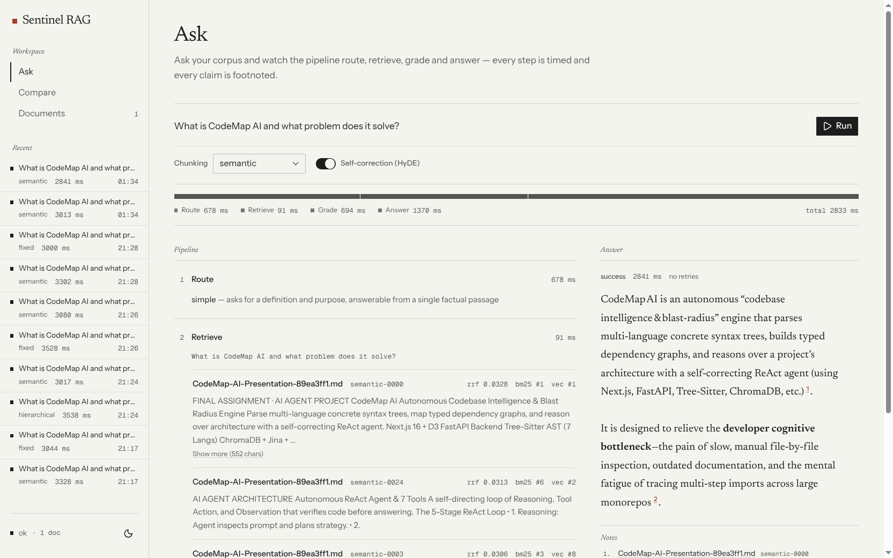
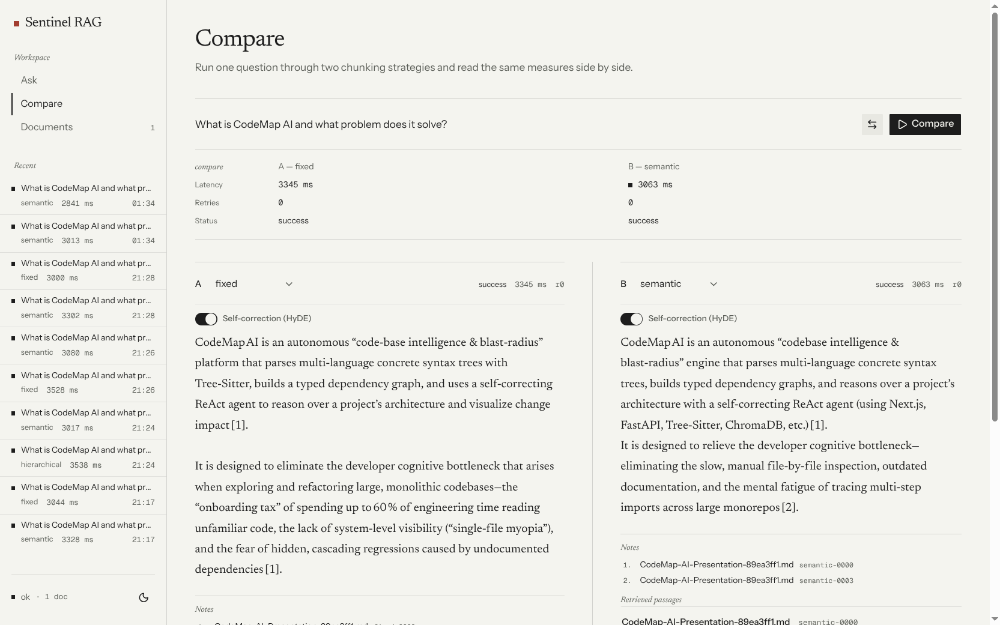
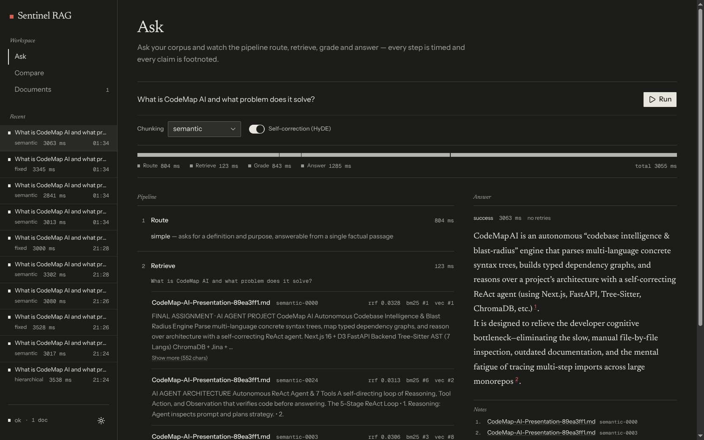
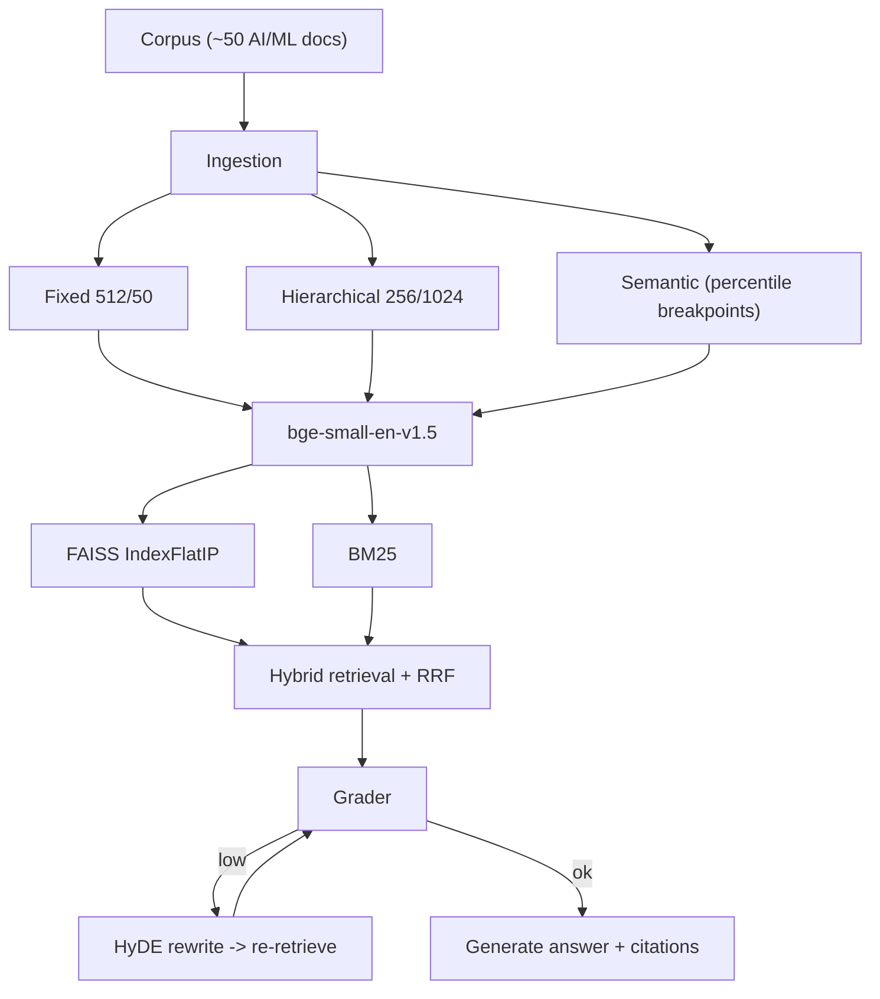

# Sentinel RAG

[](https://github.com/Agent2509/sentinel-rag/actions/workflows/ci.yml)
[](LICENSE)
[](https://www.python.org/)
[](https://nextjs.org/)

> "Most RAG systems fail silently. Mine knows when it's failing, fixes itself, and shows you the receipts."

A locally hosted, self-correcting RAG laboratory. Ask a question and watch the answer get routed, retrieved, graded, rewritten with HyDE, and cited — with every step on screen. Three chunking strategies and a hybrid BM25 + FAISS retriever.

## Screenshots



| Compare — side-by-side and delta | Dark theme |
|---|---|
|  |  |

## What it does

- **Three chunkers, one corpus.** Fixed (512/50), hierarchical (256/1024), and semantic (percentile breakpoints) — switch per query and compare.
- **Hybrid retrieval.** BM25 + FAISS fused with reciprocal rank fusion, so lexical and vector hits both count.
- **Self-correction.** An LLM grader scores the retrieved passages; a low score triggers a HyDE rewrite and a re-retrieve, capped at 2 retries.
- **Receipts.** Every step streams to the UI over SSE and is stored in SQLite, with citations that jump to the source chunk.

## Quickstart

```bash
cd backend
uv venv .venv --python 3.12
uv pip install --python .venv/bin/python torch --index-url https://download.pytorch.org/whl/cpu
uv pip install --python .venv/bin/python -r requirements.txt
cp .env.example .env          # add GROQ_API_KEY — the free tier is enough for a demo
python scripts/gen_corpus.py  # optional: seed the 50-doc demo corpus (or drop your own .md files in data/corpus/)
python -m app.ingest          # build the indexes for whatever is in data/corpus/
uvicorn app.main:app --port 8000
```

```bash
cd frontend
pnpm install
pnpm dev                      # http://localhost:3000
```

Ask **`What is LoRA?`** — the reliable success demo. The navbar health dot turns amber if the indexes are missing.

<details>
<summary>Full setup: CLI, tests, generated docs</summary>

### CLI

```bash
python -m app.pipeline "How does attention differ from RNN sequence processing?"
python -m app.pipeline "What is LoRA?" --strategy fixed
python -m app.pipeline "self correction retrieval" --no-correction
python -m app.verify          # query every index, print top hits
```

### Tests

```bash
cd backend && python -m pytest tests/     # API, documents, retrieval, ingest, LLM JSON
cd frontend && pnpm test                  # query-stream hook (Vitest)
cd frontend && pnpm lint && pnpm build
```

The backend suite runs deterministic self-checks (`scripts/check_*.py`) with stubbed embeddings and temp indexes — no network, no model download. CI runs both suites on every push.

### Generated deliverables (gitignored)

- `make_deck.py` → `Sentinel_RAG.pptx` (15 slides)
- `build_plain_english_guide.py` → `Sentinel_RAG_Comprehensive_Guide.{html,pdf}`

</details>

## How it works



A router labels the query simple or complex to pick a retrieval depth. The retriever fuses BM25 and vector hits, the grader judges whether the passages can answer the query, and a failure sends the query through a hypothetical-document rewrite before one more retrieval. The final answer must cite the passages it used; an answer that cites nothing is reported as `not_found` instead of being passed off as grounded. See [`IMPLEMENTATION_PLAN.md`](./IMPLEMENTATION_PLAN.md) for the full design.

## Engineering notes

<details>
<summary>Why the code looks the way it does</summary>

- **Atomic index swaps.** A reindex writes to a staging directory and swaps files while holding the retriever lock, so a query can never load a new `.faiss` against an old `chunks.json`. A count tripwire fails loudly if the pair is ever mismatched.
- **Key pooling.** Requests round-robin across `GROQ_API_KEY*` accounts and evict a key on a 401, with the pool guarded by a lock.
- **Cancellation is a trace.** If the client disconnects mid-stream, the server persists a `cancelled` trace with the steps it got instead of losing the run.
- **Untrusted corpus text.** Uploaded passages are delimited and the system prompt says to treat them as data, not instructions. It is mitigation, not a guarantee.
- **Tested where it matters.** The stream hook's abort/reset behavior, the index swap, and the reindex race all have tests.

</details>

## Limits

- Local only — no hosted demo, so it uses your Groq free-tier quota.
- The corpus is synthetic AI/ML text; answers are grounded in whatever you upload.

## License

MIT — see [LICENSE](LICENSE).
