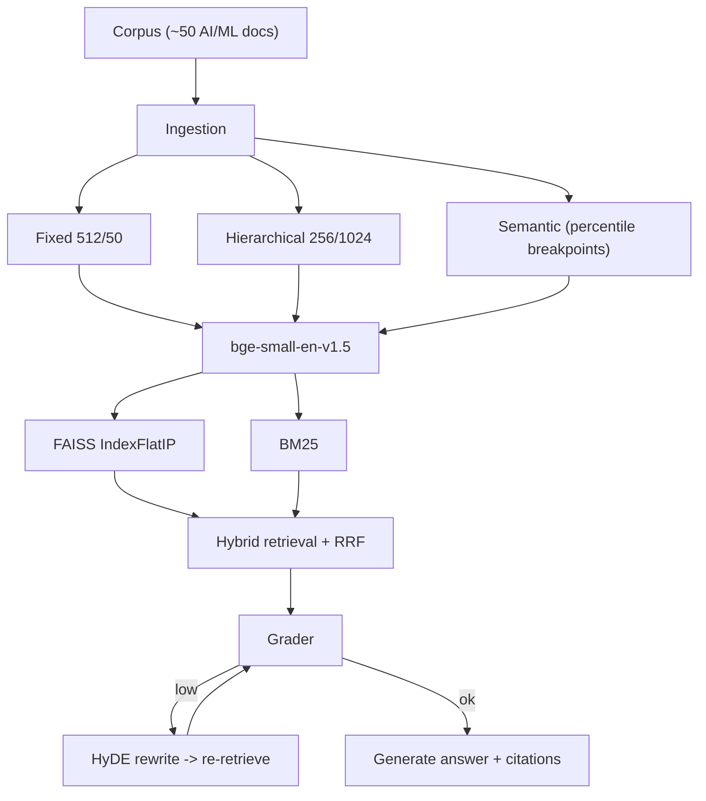

# Sentinel RAG

> "Most RAG systems fail silently. Mine knows when it's failing, fixes itself, and shows you the receipts."

A locally hosted, self-correcting RAG laboratory: 3 chunking strategies, a hybrid
BM25 + FAISS retriever with RRF fusion, an agentic self-correction loop
(Grader + HyDE), and RAGAS-evaluated metrics in a live web UI.

See [`IMPLEMENTATION_PLAN.md`](./IMPLEMENTATION_PLAN.md) for the full design.

## Architecture



## Status

- [x] **M1** Ingestion: 3 chunkers, FAISS + BM25 indexes, CLI verify
- [x] **M2** Full pipeline from CLI (router, grader, HyDE, trace)
- [x] **M3** FastAPI server (SSE, SQLite persistence, health)
- [x] **M4** RAGAS evaluation (test set, 6-combo matrix, results.json)
- [x] **M5** Frontend (Trace View, Strategy Lab, Scoreboard)
- [x] **M7** Document upload (upload/list/delete, live reindex)
- [ ] **M6** Polish

## Run (backend)

```bash
cd backend
uv venv .venv --python 3.12
uv pip install --python .venv/bin/python torch --index-url https://download.pytorch.org/whl/cpu
uv pip install --python .venv/bin/python -r requirements.txt

python scripts/gen_corpus.py     # write ~50 docs to data/corpus/
python -m app.ingest             # build FAISS + BM25 indexes
python -m app.verify             # query every index, print top hits

cp .env.example .env             # then add GROQ_API_KEY
python -m app.pipeline "How does attention differ from RNN sequence processing?"
python -m app.pipeline "What is LoRA?" --strategy fixed
python -m app.pipeline "self correction retrieval" --no-correction
python scripts/check_pipeline.py # deterministic control-flow self-check (no LLM)


# API server (SSE = /api/query; also /api/health, /api/trace/{id}, /api/strategies,
# /api/documents (upload/list/delete), /api/reindex, /api/corpus, /api/eval)
uvicorn app.main:app --host 127.0.0.1 --port 8000
python scripts/check_api.py      # deterministic API self-check (no LLM)
python scripts/check_eval.py     # deterministic eval-harness self-check (no LLM)
```

### Frontend

```bash
cd frontend
pnpm install
pnpm dev            # http://localhost:3000  (backend must be on :8000)
pnpm build          # typecheck + production build
```

- **Trace View** (`/`) — streams the pipeline over SSE (fetch-stream), animated step cards, answer + citations.
- **Strategy Lab** (`/strategy`) — run one query on two strategies side by side.
- **Documents** (`/documents`) — upload `.md`/`.txt`/`.pdf`; each upload re-embeds the corpus and rebuilds all three indexes live.
- **Scoreboard** (`/scoreboard`) — RAGAS metrics per strategy from `GET /api/eval` (empty until the eval runs).
- API base defaults to `http://127.0.0.1:8000`; override with `NEXT_PUBLIC_API_BASE`.

### Evaluation (separate `.venv-eval`)

```bash
uv venv .venv-eval --python 3.12
uv pip install --python .venv-eval/bin/python torch --index-url https://download.pytorch.org/whl/cpu
uv pip install --python .venv-eval/bin/python -r requirements-eval.txt

.venv-eval/bin/python -m eval.build_testset              # 50 Q/A rows -> eval/testset.jsonl
.venv-eval/bin/python -m eval.run_ragas --smoke          # quick check (1 combo, 5 q)
.venv-eval/bin/python -m eval.run_ragas --limit 20       # first 20 rows/strategy -> eval/results.json
.venv-eval/bin/python -m eval.run_ragas --limit 0 --resume   # all rows, fill gaps across quota resets
```

> **Note:** the full matrix is judge- and pipeline-LLM heavy. On Groq's free tier
> the daily token cap is easy to exhaust (the pipeline's router/grader also use
> Groq), which makes every query fall back to `not_found`. Run the full matrix on
> a paid tier, or after the quota resets. The harness itself is verified by
> `scripts/check_eval.py` and the `--smoke` run.

## Evaluation

> **Harness notes.** An earlier `results.json` was invalid: 118/120 answers were the
> fallback message. The dominant cause was a citation-parsing bug — `gpt-oss-120b`
> sometimes wraps citations in CJK/fullwidth brackets (`【1】`) instead of `[1]`, and
> the ASCII-only validator rejected them, so grounded answers were discarded as
> ungrounded. `app/generate.py` now normalizes those markers. The pipeline trace also
> carries a `fallback_reason`, and the harness records per-sample diagnostics
> (`final_status`, `fallback_reason`, `grader_score`, `source_doc_hit`) and **refuses
> to overwrite a good run** when the LLM is rate-limited (probe + abort-on-error-rate).
> Re-run to regenerate the matrix; use `--resume` to fill it across free-tier quota
> resets.

Partial run (`--limit 10`, 3 of 6 combos). Measured with **`openai/gpt-oss-20b`** for both
pipeline and judge, because the `gpt-oss-120b` free-tier quota was exhausted and the keys
then available were all on one Groq account (Groq limits are **per account**, not per key).
Separate accounts do add headroom: the harness pools every `GROQ_API_KEY*` in the
environment and round-robins across them (pipeline) and gives each account its own judge.
Groq throttles the matrix partway, so the harness aborts cleanly and keeps what it has;
finish it later with:

```bash
.venv-eval/bin/python -m eval.run_ragas --limit 10 --resume \
  --pipeline-model openai/gpt-oss-20b --judge-model openai/gpt-oss-20b
```

| Strategy | Correction | Faithfulness | Answer Relevancy | Context Precision | Context Recall | Latency (ms) |
|---|---|---|---|---|---|---|
| fixed | on  | 1.000 | 0.868 | 0.950 | 1.000 | — |
| fixed | off | 0.967 | 0.837 | 0.950 | 1.000 | — |
| hierarchical | on  | —¹ | —¹ | 0.850 | 0.900 | — |
| hierarchical | off | _pending_ | | | | |
| semantic | on  | _pending_ | | | | |
| semantic | off | _pending_ | | | | |

¹ `n = 10` per combo. `fixed` answered **10/10**; `hierarchical/on` answered 6/10 (3 LLM
errors, 1 `not_found`) and its judge calls were throttled (`RateLimitError`), so `—` means
"not judged", not zero. Context metrics are non-LLM and always computed.
